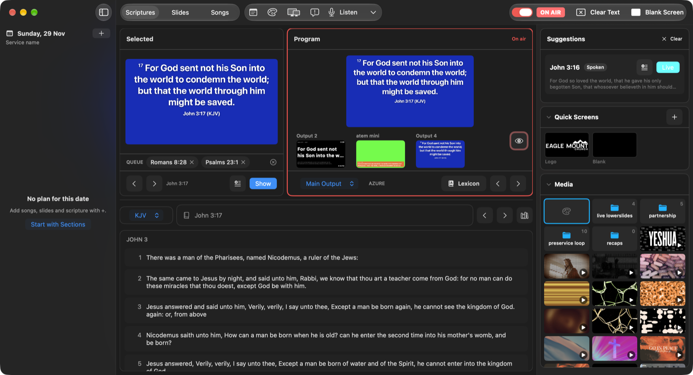

  

<h1 align="center">Euthus</h1>

  <b>Bible verses on your church screens the moment they are preached.</b> 
  A native Mac app that listens to the sermon and puts the verse up — no typing, no waiting. 
  Plus songs with chords, slides, media and a service plan: one free app for the whole Sunday.

  
  
  

  <a href="https://github.com/Rtnkr/euthus/releases/latest"><b>Download for Mac</b></a> ·
  <a href="#first-sunday-checklist">First Sunday checklist</a> ·
  <a href="https://github.com/Rtnkr/euthus/discussions">Feedback &amp; ideas</a> ·
  <a href="https://github.com/Rtnkr/euthus/issues/new/choose">Report a problem</a>

  

*Euthus* (Greek εὐθύς) means **"immediately"**, the word Mark uses again and again. That is the whole idea:
the preacher says *"turn with me to John 3:16"* and the verse is already on the screen.

## What it does

**Listens, so you don't have to type**
- Hears spoken references (*"Romans eight twenty-eight"*, *"Psalm 23"*, *"First Corinthians 13 verse 4"*) and shows them about a second after they are said.
- Follows along: *"verse 9"*, *"from 8 onwards"*, *"verses 10 to 13"*, *"next verse"*.
- Recognises verses that are **quoted without a reference**, and reads along as the preacher works through a chapter.
- Switches translation by voice: *"put this in Telugu"*, *"read it in the NIV"*.
- Understands commands even when they are misheard ("next to us" → next verse), across Indian, American, British and other accents.
- All speech recognition runs **on the Mac** (NVIDIA Parakeet, with Apple's recognizer as a fallback). Nothing from your service leaves the building.

**Built for the person at the desk**
- Selected and Program monitors; double-click or **Return** puts the verse on screen.
- An **On Air / Preview** switch: work on Program while the screens hold their picture (⌘L).
- **Clear text** (⌘C, press again to bring the words back), **Blank screen** (⌘B) and a one-click **Logo** screen.
- Type-ahead references: start typing `joh 3 16` or `song of sol 2` and Euthus jumps there as you type.
- A short list of **suggestions** (spoken, quoted, paraphrased) you can put live with one click, plus a queue.
- Keyboard first: arrows step verses or slides, number keys pick a verse, `Tab` switches to topic search.
- Arrange the toolbar your way (right-click it → Customize Toolbar…).

**The whole service in one plan**
- A **service plan** per date, Proclaim-style: sections, songs, slide decks, pictures, videos, scripture, the sermon
  and a **countdown** to the start. Name each service and jump back to any earlier one; copy last week's plan in one click.
- Drag songs, decks and pictures or videos from the Media panel straight into the plan; add a PDF or PowerPoint from
  the plan's **+** menu. ⌘/⇧-click to pick several items and press Delete.
- **Looping sections**: set a pre-service or post-service loop to change every few seconds; its pictures, videos and
  decks play in turn and start again. → past the end of an item moves on to the next.

**Songs with chords**
- Search **Ultimate Guitar** and import in one click, or paste/import **ChordPro** (chords-over-lyrics sheets convert on the spot).
- Transpose, key and CCLI, **song order** (Verse 1, Chorus, Bridge…), 1–4 lines per slide, and long lines split in two
  automatically so the words stay big.
- Jump by section from the keyboard: `V` verse, `C` chorus, `P` pre-chorus, `B` bridge, `I` intro, `E` ending (`V` then `2` = Verse 2).

**Slides and media**
- Decks of text slides, pictures and **videos with sound** (loop, mute, time left); import **PDF**, **PowerPoint** or **Keynote**.
- Files are copied into Euthus, so moving the originals never breaks a slide.

**Every screen in the room**
- Up to **four outputs**: projectors, TVs, floating windows or **NDI** for your stream.
- A **confidence monitor** for the preacher and band: the verse or lyrics with **chords over the words**, the whole next
  slide, a timer and the clock. Design it in Theme Designer › Stage screen: font, alignment, colours, and **drag and
  resize** the current and next boxes. Pictures and announcement slides show exactly as the audience sees them.
- **Lower third** on green or black for ATEM, vMix and OBS keys.
- Themes with image and video backgrounds, and a **Media** folder for live backgrounds.

**More**
- Search by **topic or phrase**, e.g. *"do not worry about tomorrow"*.
- Sermon **notes and slides**, written on the Mac, exported as PDF or Markdown.
- Alerts for the nursery or car park, and a word-study lexicon.
- Phone remote and OSC control (off until you switch it on).

  
  

## Install

1. Download **Euthus-x.y.dmg** from the [latest release](https://github.com/Rtnkr/euthus/releases/latest).
2. Open it and drag **Euthus** onto **Applications**.
3. Open Euthus. The first time, macOS says it can't verify the developer:
   open **System Settings → Privacy & Security**, scroll down and click **Open Anyway**. You only do this once.

Updates arrive inside the app: **Euthus → Check for Updates…**

**Requirements:** **macOS 26 Tahoe** or later (a Mac with Apple silicon is recommended), and a microphone
or an audio feed of the preacher.

## First Sunday checklist

Do this once, a day or two before the service:

1. **Open Euthus with the internet on.** It downloads its speech models in the background (about 450 MB, once).
2. **Allow the microphone** when asked.
3. **Settings → Audio:** pick the microphone or mixer feed and press **Test microphone**. The level bar should
   move well into the middle when someone talks normally. If it barely moves, raise **Gain**. A quiet feed is the
   most common reason verses appear slowly.
4. **Outputs:** choose the projector and, if you have them, a confidence monitor, an NDI stream or a lower-third output.
5. **Plan the service** (optional): pick the date at the top of the sidebar, then add songs, slides and media with **+**.
6. **Add your Bibles** (optional): Euthus includes the King James Version. See [Bibles](#bibles).
7. Press **Listen**, read a verse out loud, and watch it appear.

## AI assistant

Ask Claude to import songs, design announcement slides, set the service order or change the screen. Setup takes two minutes: **[AI assistant guide](docs/AI-ASSISTANT.md)**.

## Bibles

Euthus includes the public-domain **King James Version**, ready to use.

To add more translations, put Bible files in **Documents › Euthus Bibles** (or choose any folder in
**Settings → Scripture**). Euthus reads **Zefania XML**, **OpenSong XML** and **MyBible (.SQLite3)** modules, including
Telugu and other non-English Bibles. If a file can't be read, Settings says which one.

Please use only translations your church is licensed to use. Euthus does not supply copyrighted translations.

## Feedback

This is a young app, and your feedback shapes it.

- 💬 **Ideas, questions, "how do I…"** → [Discussions](https://github.com/Rtnkr/euthus/discussions)
- 🐞 **Something went wrong** → [Report a problem](https://github.com/Rtnkr/euthus/issues/new/choose).
  If it is about detection, please attach the log: in Finder press ⇧⌘G and open `~/Library/Logs/Euthus.log`.

## Privacy

Euthus has no account, no analytics and no tracking. Speech is recognised on your Mac and stays there.
The app goes online only to download its speech models, to check GitHub for updates, and to talk to the
devices *you* connect (NDI, linked Macs, phone remote). Details: [PRIVACY.md](PRIVACY.md).

## License

Euthus is **free to download and use** in any church, ministry or home.
It is **not open source**: the app, its name and its design are © Ratnakar Boddu, all rights reserved.
You may not copy, modify, redistribute, sell, or present Euthus as your own work. See [LICENSE.md](LICENSE.md).

Made for the local church. Soli Deo gloria.

