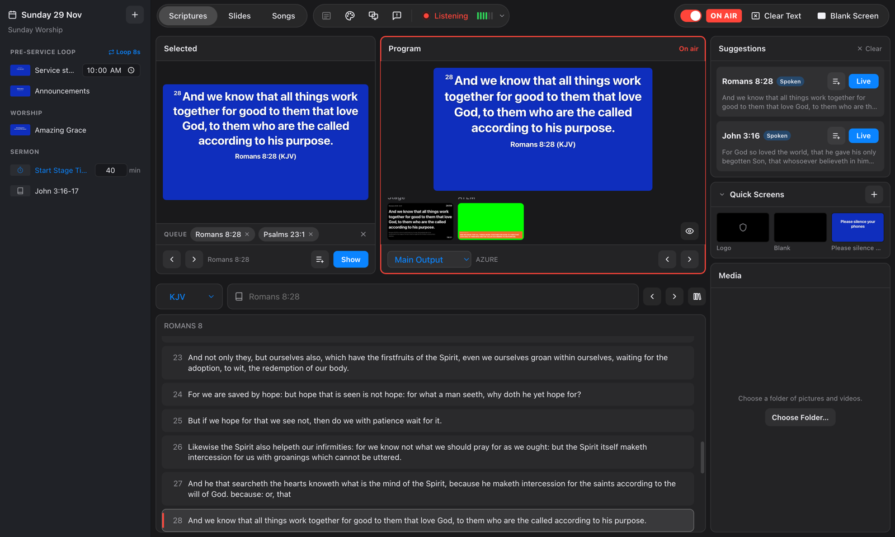
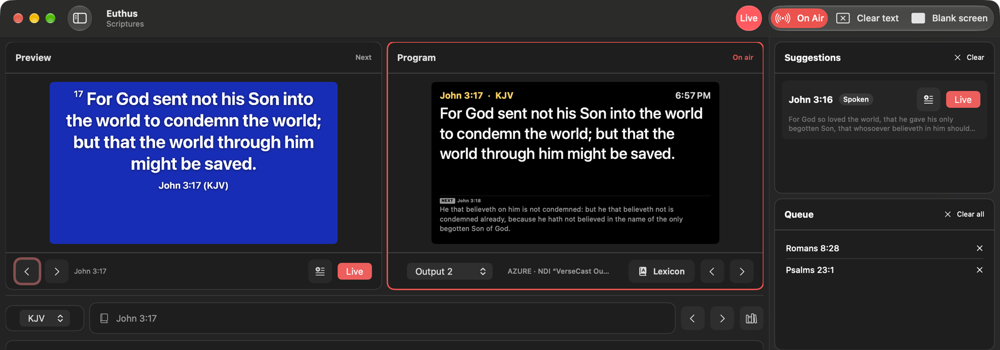

  

<h1 align="center">Anthem</h1>

  <b>Worship presentation software that puts the verse on screen the moment it's preached.</b> 
  Songs with chords, scripture, slides, media and the whole service plan, with a listening assistant that follows the sermon. 
  Free for churches, on Mac and Windows.

  <a href="https://github.com/Rtnkr/anthem/releases/latest/download/Anthem-Mac.dmg"><b>Download for Mac</b></a> ·
  <a href="https://github.com/Rtnkr/anthem/releases/latest/download/Anthem-Windows-x64.exe"><b>Download for Windows</b></a> ·
  <a href="#getting-started">Getting started</a> ·
  <a href="https://github.com/Rtnkr/anthem/discussions">Community</a>

  
  
  
  

  

The preacher says *"turn with me to John 3:16"*, and the verse is already on the screen. Anthem listens to the sermon,
recognises Bible references as they are spoken and puts them up about a second later, while you run songs, slides and
media from one calm, keyboard-first window.

## Features

**Listens, so you don't have to type**
- Hears spoken references (*"Romans eight twenty-eight"*, *"Psalm 23"*, *"First Corinthians 13 verse 4"*) and follows
  along: *"verse 9"*, *"verses 10 to 13"*, *"next verse"*.
- Switches translation by voice: *"read it in the NIV"*, *"put this in Telugu"*.
- Understands Telugu sermons on the Mac with its own on-device Telugu model.
- Speech recognition runs on your computer. Nothing from your service leaves the building.

**Built for the person at the desk**
- Selected and Program side by side, with the other screens (stage, stream) previewed underneath.
- An **On Air / Preview** switch, **Clear Text**, **Blank Screen**, and **Quick Screens**: Logo, Blank and your own
  ready-made screens, one click away.
- Type-ahead references (`joh 3 16`), a verse queue that is always in view, and suggestions you can put live in one click.

**The whole service in one plan**
- A service plan per date: sections, songs, decks, scripture, media, countdowns and **stage-timer cues** that count
  down on the confidence screen.
- Thumbnails beside every item, drag and drop from the library and the Media panel, and a picture or video background
  for any song, deck or passage.
- Looping pre-service and post-service sections.

**Songs with chords**
- Import ChordPro or chords-over-lyrics sheets; transpose, song order and lines per slide.
- Chords appear over the words on the stage screen only.

**Every screen in the room**
- Up to four outputs. Each one is **Audience**, **Stage** or **Stream / ATEM**: the stream screen sets the words as a
  lower third on a key colour for your switcher, with pictures and videos full screen.
- Themes with image and video backgrounds and an optional box behind the words; alerts to the screens you choose.
- NDI output, a phone remote and linked Macs (Mac).

  
  

## Download

| | |
|---|---|
| **Mac** | [Anthem-Mac.dmg](https://github.com/Rtnkr/anthem/releases/latest/download/Anthem-Mac.dmg) · macOS 14 Sonoma or later · Apple silicon or Intel |
| **Windows** | [Anthem-Windows-x64.exe](https://github.com/Rtnkr/anthem/releases/latest/download/Anthem-Windows-x64.exe) · Windows 10 or 11, 64-bit |

Apple silicon is recommended for listening on a Mac. On Windows, Telugu listening, NDI, the phone remote, sermon notes
and PDF/PowerPoint import are coming in later releases.

## Getting started

**Install**
- **Mac:** open the DMG and drag **Anthem** to **Applications**. The first time you open it, macOS asks you to confirm:
  **System Settings → Privacy & Security → Open Anyway**. Updates then arrive inside the app (**Anthem → Check for Updates…**).
- **Windows:** run the installer. If Windows shows *"Windows protected your PC"*, choose **More info → Run anyway**.

**Before your first Sunday**
1. Open Anthem with the internet on. It downloads its speech model once (about 450 MB).
2. Allow the microphone, then in **Settings → Audio** pick the microphone or the mixer feed and press **Test Microphone**.
   A clear feed of the preacher is the single biggest factor in how quickly verses appear.
3. In **Outputs**, choose the projector, and if you have them a stage screen and a stream output.
4. Plan the service: choose the date at the top of the sidebar and add songs, slides and scripture with **+**.
5. Press **Listen**, read a verse aloud, and watch it appear.

**Bibles.** Anthem includes the public-domain King James Version. To add more, put Zefania XML, OpenSong XML or
MyBible files in **Documents › Anthem Bibles**, or choose a folder in **Settings → Scripture**. Please use only
translations your church is licensed to use.

**AI assistant (Mac).** Ask Claude to import songs, design announcement slides or set the service order:
[two-minute setup](docs/AI-ASSISTANT.md).

## Community and support

- **Questions and ideas:** [Discussions](https://github.com/Rtnkr/anthem/discussions)
- **Something went wrong:** [Report a problem](https://github.com/Rtnkr/anthem/issues/new/choose). For listening
  problems on a Mac, attach `~/Library/Logs/Anthem.log`.
- **What's new:** [Changelog](CHANGELOG.md)

## Privacy

No account, no analytics, no tracking. Speech is recognised on your computer and stays there. Anthem goes online only
to download its speech models and to check for updates. Details: [PRIVACY.md](PRIVACY.md).

## License

Anthem is free to download and use in any church, ministry or home. It is not open source: the app, its name and its
design are © Ratnakar Boddu, all rights reserved. See [LICENSE.md](LICENSE.md).

Made for the local church. Soli Deo gloria.

